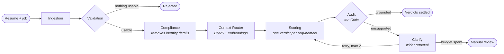

<div align="center">


# ARKIVE

### A Multi-Agent System for HR Skill-Matching and Decision Support using Hybrid RAG with BM25 and LangGraph

<p align="center">
  
  
  
  
  
  
  
</p>

**BS Computer Science Capstone Project**<br />
Manuel S. Enverga University Foundation, Lucena City

</div>

---

## Overview

ARKIVE is an AI-assisted recruitment and decision-support system built for the
Human Resources Department of MSEUF. It takes an applicant from a public job
posting through résumé screening, an AI skill match, examinations, a chain of
interviews and a final hiring decision, and records the evidence behind every
step.

The AI never makes the hiring call. Its job is to read documents faster than a
person can, show **where in the résumé** each requirement is met, and hand HR a
weighted, explainable summary. Every decision stays with a human, and every
decision is recorded with who made it, when, why, and the scores at that
moment.

**What makes it different from a keyword filter:**

- **Evidence, not just a number.** Every requirement gets a verdict (met,
  partly met, not met) that quotes the exact résumé line it rests on. A verdict
  whose quote cannot be found in the résumé earns no credit.
- **Two independent looks.** Half of the match score is plain arithmetic
  (BM25 keywords plus semantic similarity), the other half is the agents'
  verdicts. The model never writes a number and never sees the arithmetic half.
- **Bias-aware by design.** A Compliance Agent removes identity details from
  the evidence before any agent judges it.
- **A process that cannot be skipped.** Each job's hiring stages form a finite
  automaton, so a candidate can only move forward one stage at a time, in the
  order that job defines.

---

## Key Features

### Three portals, one system

| Applicant | HR Administrator | Evaluator |
|---|---|---|
| Browse and search the public job board | Create job openings with an AI-drafted description | See only the interviews assigned to them |
| Apply and upload a résumé (PDF) | Design each job's hiring workflow | Read the candidate's full profile |
| Review the AI-extracted profile before submitting | Run the candidate pipeline | Submit a scored evaluation |
| Answer pre-screening questions | Schedule exams and interviews, enter results | Request a different schedule |
| Pick exam and interview times | Compare finalists and make the decision | |
| Track progress, get notified, withdraw | Invite staff and manage access | |

Screens update on their own as other people act, with a notification bell for
every schedule, result and decision.

---

### AI résumé and job description reading

Applicants upload a PDF and an agent fills in their name, contact details,
education, work history and skills, which they review and correct before
submitting. HR does the same with job descriptions: upload the PDF, and the
Job Opening Builder drafts the department, description, qualifications and
requirements for HR to edit and approve. A scanned résumé with no text layer
is transcribed from its page images by the model.

---

### Hybrid RAG skill matching

The core of ARKIVE. Each requirement of the job is matched against the
applicant's résumé in two independent ways, then blended:

```text
match = 0.5 × arithmetic  +  0.5 × requirement coverage

arithmetic (per requirement) = 0.6 × semantic similarity  +  0.4 × BM25 keyword score
coverage                     = verified "met" = 1, verified "partial" = 0.5, else 0
```

The coverage half comes from a LangGraph pipeline of seven agents. Which agent
runs next is decided by a transition table kept as plain data, and the tests
check that the compiled graph matches it edge for edge:



- Scoring can never run before Compliance, and the Critic loop is bounded, so
  the graph always stops.
- Applicants scoring below **60** are flagged, not rejected. HR decides
  whether to continue them.
- The full method, constants and their reasons are in
  [docs/ARKIVE-skill-matching-algorithm.md](docs/ARKIVE-skill-matching-algorithm.md),
  with an evaluation harness in
  [backend/scripts/eval_skill_matching.py](backend/scripts/eval_skill_matching.py).

---

### Configurable hiring workflows

HR chooses which stages each job uses, from document upload and pre-screening
through shortlisting, up to four examinations and up to six interview rounds,
to the final decision and onboarding. A senior post can have three interviews
and an exam; a part-time role far less. The workflow becomes that job's stage
automaton, and the server refuses any move that is not the next stage.

---

### Examinations and interview scheduling

- Applicants pick from the exam sittings HR opens. HR enters the score
  afterwards and the applicant sees their **percentile rank** among everyone
  who sat that exam.
- Evaluators publish their free time, which is cut into interview slots.
  Applicants choose a slot or ask for another; HR approves or declines.
- Evaluators score candidates on a structured scorecard, and an agent
  summarises the interview evidence for HR.

---

### Candidate Profile and decision support

The Candidate Profile is the most important screen for HR: synthesis,
pre-screening, shortlisting, examinations, interviews and documents, all in
one place.

The **Synthesis** tab gives a final weighted score built from four criteria,
each shown with its weight and actual contribution:

| Criterion | Weight |
|---|---|
| Skill match | 56.9% |
| Interview rubric coverage | 35.1% |
| Evaluator chain consensus | 4.3% |
| Examination | 3.7% |

When a score cannot be produced yet, it says exactly which criteria are
missing and whether they can ever arrive. Interview rounds are combined
30 / 30 / 40, so the final round counts most.

The **Final Decision Board** ranks every finalist for a job side by side. HR
can hire or reject from any stage, but an incomplete decision is made
deliberate: ARKIVE lists what is missing and asks for a reason. The board
exports to a spreadsheet, and once a candidate is hired their full record
(résumé, exam results, scorecards, decision and scores) is compiled into one
**Pre-201 package**.

---

### Accounts and security

- Role-based access: applicants, HR administrators (with a super admin
  switch) and evaluators each see only what their role allows.
- Staff join by email invitation; applicants verify their email.
- Password reset, email change by link, profile photo, and account deletion
  that erases the person while keeping the hiring record.
- Rate-limited sign-up and login lockout, strict browser security headers, and
  HTTPS through Caddy in deployment.

---

## Tech Stack

| Layer | Technology |
|---|---|
| Frontend | React 19, TypeScript, Vite, React Router |
| Backend | FastAPI, Pydantic, SQLAlchemy 2, Alembic |
| AI agents | LangGraph, LangChain, OpenAI GPT-4o-mini and `text-embedding-3-small` |
| Retrieval | BM25 (`rank_bm25`) + embedding cosine similarity |
| Database | PostgreSQL 16 |
| Documents | PDF text extraction, model transcription for scanned résumés, PDF reports |
| Deployment | Docker Compose, Caddy (HTTPS), on-premises or cloud |
| Testing | pytest (backend), Vitest (frontend) |

---

## Getting Started

### Prerequisites

The only requirement is **Docker Desktop**. Every service runs in a
container, so setup is the same on macOS, Windows and Linux. An **OpenAI API
key** is needed for the AI features; without one the rest of the system still
runs and the AI screens say it is not configured.

### Installation

```bash
git clone https://github.com/Asvg18/ARKIVE-Platform.git
```

```bash
cd ARKIVE-Platform
```

### Environment variables

Copy the two example files:

```bash
cp .env.example .env && cp backend/.env.example backend/.env
```

Then fill in `backend/.env`, which is the file the development server reads:

```env
JWT_SECRET_KEY=any_long_random_string
OPENAI_API_KEY=your_openai_api_key
```

Generate a JWT key with
`python -c "import secrets; print(secrets.token_hex(32))"`. Email settings
(`SMTP_*`) are optional; without them emails are logged instead of sent.

### Run it

```bash
docker compose up -d --build
```

| | |
|---|---|
| App | http://localhost:5173 |
| API | http://localhost:8000 |
| API docs | http://localhost:8000/docs |

Database migrations run automatically on every start. To fill the system with
demo accounts and a sample hiring pipeline:

```bash
docker compose exec backend python -m scripts.seed_demo_users
```

```bash
docker compose exec backend python -m scripts.seed_demo_pipeline
```

| Role | Email |
|---|---|
| Applicant | `applicant@arkive.demo` |
| HR Administrator | `hr@arkive.demo` |
| Evaluator | `depthead@arkive.demo` |
| Second evaluator | `vp@arkive.demo` |

All demo accounts share the password `demo-password-123`. They are for local
testing only; never seed them on a real deployment.

<details>
<summary><b>More development notes</b></summary>

<br />

**Everyday commands**

```bash
docker compose logs -f backend
```

```bash
docker compose exec backend pytest
```

```bash
docker compose exec db psql -U arkive -d arkive
```

```bash
docker compose down
```

The API and frontend hot-reload from your files. `--build` is only needed the
first time and after `requirements.txt` or `package.json` changes. `down`
keeps the database (it lives in a Docker volume); add `-v` to wipe it.

**Each machine has its own database.** Docker makes the environment
reproducible, not the data. Use the seed scripts for a comparable demo state,
or copy a snapshot:

```bash
docker compose exec -T db pg_dump -U arkive arkive > snapshot.sql
```

```bash
docker compose exec -T db psql -U arkive -d arkive < snapshot.sql
```

To share one database, put a managed Postgres connection string (Neon,
Supabase) in `DATABASE_URL` in the root `.env`.

**Running natively.** Start only the database with
`docker compose up -d db`, then run the API from `backend/` (it reads `.env`
from its working directory) and the frontend from `frontend/`. In VS Code,
the **Run Full Stack (Backend + Frontend)** launch configuration handles both
on every OS.

</details>

---

## Project Structure

```text
ARKIVE-Platform/
├── backend/
│   ├── app/
│   │   ├── api/          # HTTP routes: applicant, hr, evaluator, auth, account
│   │   ├── domain/       # Pure rules: stage automaton, retrieval automaton, scoring
│   │   ├── services/     # Use cases and the AI agents (skill_matching/, agents/)
│   │   ├── models/       # SQLAlchemy tables
│   │   ├── schemas/      # Request and response shapes
│   │   └── infra/        # Config, database, security
│   ├── alembic/          # Database migrations
│   ├── scripts/          # Seed data, first admin setup, evaluation harness
│   └── tests/            # pytest suite, including architecture rules
├── frontend/
│   └── src/
│       ├── features/     # applicant, hr, evaluator, auth, account, notifications
│       │                 # each split into view/, model/, controller/
│       └── shared/       # API client, UI kit, styles
├── docs/                 # Architecture, algorithm, deployment and team guides
├── docker-compose.yml        # Development stack
├── docker-compose.prod.yml   # Deployment stack with Caddy
└── Caddyfile
```

How the layers depend on each other, and the import rules the tests enforce,
are in [docs/ARKIVE-architecture.md](docs/ARKIVE-architecture.md).

---

## Deployment

ARKIVE ships with an on-premises stack (`docker-compose.prod.yml`): Caddy
serves the built frontend over HTTPS and proxies the API, so one machine can
host it for a whole office over the local network. It can also run on a cloud
server with a managed Postgres, storing uploaded files in an S3-compatible
bucket. See
[docs/ARKIVE-deployment.md](docs/ARKIVE-deployment.md).

---

## Scope and Limitations

- AI verdicts support HR's judgement; they are not a hiring decision. Low
  scores flag an application for a person to review, never reject it.
- Language-model output varies slightly between runs. Degree requirements are
  settled by rules, and unverifiable verdicts earn no credit, to keep scores
  stable.
- Examinations are taken offline; ARKIVE schedules them and records results.
- Résumés and job descriptions are uploaded as PDFs.
- Built for MSEUF's HR process; other organisations would adjust the
  workflow stages and synthesis weights.

---

## Documentation

| Guide | What it covers |
|---|---|
| [Architecture](docs/ARKIVE-architecture.md) | Folder layout, layers and import rules |
| [Skill matching algorithm](docs/ARKIVE-skill-matching-algorithm.md) | The score, retrieval, the agent pipeline and its constants |
| [Deployment](docs/ARKIVE-deployment.md) | On-premises stack, certificates, LAN access, cloud options |
| [Operations notes](docs/ARKIVE-operations-notes.md) | Connection pool, AI clients, configuration switches |
| [Team Guide (PDF)](docs/ARKIVE-Team-Guide.pdf) | What every role can do, screen by screen |

---

## Team

**Manuel S. Enverga University Foundation, Lucena City**<br />
College of Computing and Multimedia Studies · BS Computer Science, Software Engineering

- Dave Andrei P. Capistrano
- Aerron Sander V. Gumarao
- Kenneth S. Villabroza
